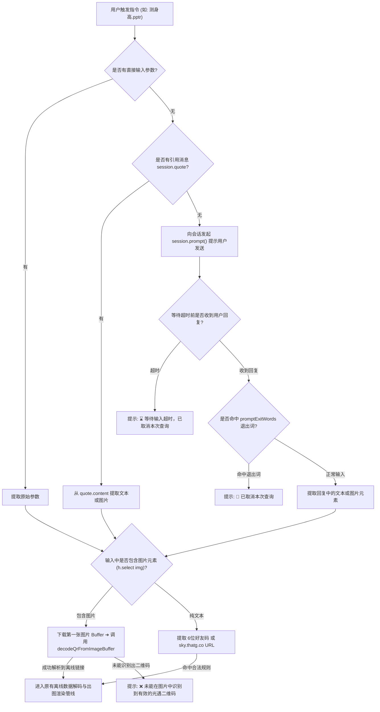

# 20261013 二维码参数与 session.prompt 交互扩展规划

## 1. 需求背景与核心目标

当前《光·遇》国服玩家在游戏内导出个人装扮与身高档案时，最主流的操作即为导出带有黑白二维码的名片。此前插件仅支持纯文本的 6 位好友码或 `https://sky.thatg.co/o=...` 离线链接参数，在手机端使用与转发时存在操作门槛。

### 核心设计目标
1. **全链路多模态支持**：支持直接携带二维码图片、引用带图消息或空参交互触发发图，实现自动解析与查询。
2. **渐进式交互等待**：当指令未附带参数且无上下文引用时，自动开启 `session.prompt` 引导输入，避免冷漠报错。
3. **低侵入架构设计**：逻辑收敛于输入解析层，无缝赋能现有的 `pptr`、`takumi`、`api`、`text`、`forward`、`md-table`、`md-style` 全套 8 种指令。

---

## 2. 图像解码与二维码识别技术选型

针对 Node.js / Koishi 生态环境，明确选定最具兼容性与轻量化的纯 JavaScript / TypeScript 方案组合（`jimp` + `jsqr`）。

| 模块 | 选用库 | 核心职责 | 关键特性与优势 |
| :--- | :--- | :--- | :--- |
| **图像像素解码** | `jimp` | 下载图片 Buffer 解码为像素矩阵 | • 100% 纯 JS 实现，**零 Native 编译依赖**，绝无 node-gyp 失败隐患<br>• 内置轻量缩放与灰度预处理能力，在 Koishi 插件生态广泛验证 |
| **二维码点阵识别** | `jsqr` | 从 RGBA 像素矩阵中提取 QR 文本数据 | • 纯 TS 算法实现，体积极小（~150KB），内存开销低<br>• 对标准点阵二维码（光遇名片标准格式）识别率高且解析耗时在几十毫秒级 |

### 核心识别逻辑原型：
```ts
import Jimp from 'jimp'
import jsQR from 'jsqr'

export async function decodeQrFromImageBuffer(buffer: Buffer): Promise<string | null> {
  const image = await Jimp.read(buffer)
  // 若原始截图分辨率过大（如高于 1600px），可按比例缩放以加快解析速度并降低内存占用
  if (image.bitmap.width > 1600) {
    image.resize(1600, Jimp.AUTO)
  }
  const { data, width, height } = image.bitmap
  const qr = jsQR(new Uint8ClampedArray(data.buffer), width, height)
  return qr?.data ?? null
}
```

---

## 3. 统一输入提取链路与状态机



---

## 4. `session.prompt` 细节设计与配置规范

### 4.1 新增配置项（Schema）
在 `Config` 中新增交互式输入控制项：
- `enablePromptInput` (`boolean`，默认 `true`)：未带参数且无引用时，是否启用交互式多轮等待。
- `promptTimeout` (`number`，默认 `30`)：等待用户输入的超时时间（秒）。
- `promptExitWords` (`string[]`，默认 `['取消', 'exit', 'quit', '0', '-1']`)：主动取消交互的关键词列表，配置项呈现为文本数组列表，判定时自动去除首尾空格并忽略大小写。

### 4.2 交互提示语与体验优化
1. **引导提示**：
   > 🔍 请在 30 秒内发送：好友码（如 `123-456`）、离线扫码链接（`https://sky.thatg.co/o=...`）或游戏内扫码图片。<br>发送 `取消` / `0` 可退出。
2. **多图输入策略**：若单条消息包含多张图片，默认优先识别第一张图片；若失败可平滑尝试下一张。
3. **元素提取协议兼容**：采用 Koishi `h.select(content, 'img')` 提取 `src` 属性，无缝跨越 QQ 官方平台、OneBot 等所有已接入协议适配器。

---

## 5. 异常处理矩阵

| 场景 | 现象 | 处理策略与用户反馈 |
| :--- | :--- | :--- |
| **空参无交互** | 用户未发参数且 `enablePromptInput = false` | 回退原行为，展示指令用法提示与帮助信息 |
| **交互超时** | 用户超过 `promptTimeout` 未回复任何消息 | 发送 `⌛ 等待输入超时，已取消本次查询。` 优雅收尾 |
| **主动取消** | 用户回复内容完全匹配 `promptExitWords` 任意项 | 发送 `🚪 已取消本次查询。` 并结束本次 prompt 会话 |
| **图片无 QR** | 提供了普通表情包或无关风景截图 | 发送 `❌ 未能在图片中识别到有效二维码，请确认发送光遇名片图片。` |
| **二维码非光遇**| 二维码解码出非 `sky.thatg.co` 相关链接 | 发送 `⚠️ 识别到二维码，但不是支持的光遇好友/装扮离线链接。` |

---

## 6. 实施落地计划

1. **步骤一（依赖安装）**：在插件根目录 `package.json` 安装 `jimp` 与 `jsqr`，并补全 `@types/jsqr`。
2. **步骤二（扫码服务层）**：在 `src/services/qrcode.ts` 中实现图像下载、预缩放防爆与 QR 解析函数。
3. **步骤三（配置项扩充）**：在 `src/config.ts` 补充 `enablePromptInput`、`promptTimeout` 与 `promptExitWords`。
4. **步骤四（公用解析器重构）**：在 `src/command/common.ts` 中实现统一解析方法，全量注入 8 大指令。
5. **步骤五（自动化验证）**：添加单元测试覆盖直接好友码、离线链接、二维码 Buffer 及 prompt 退出等全部分支。
