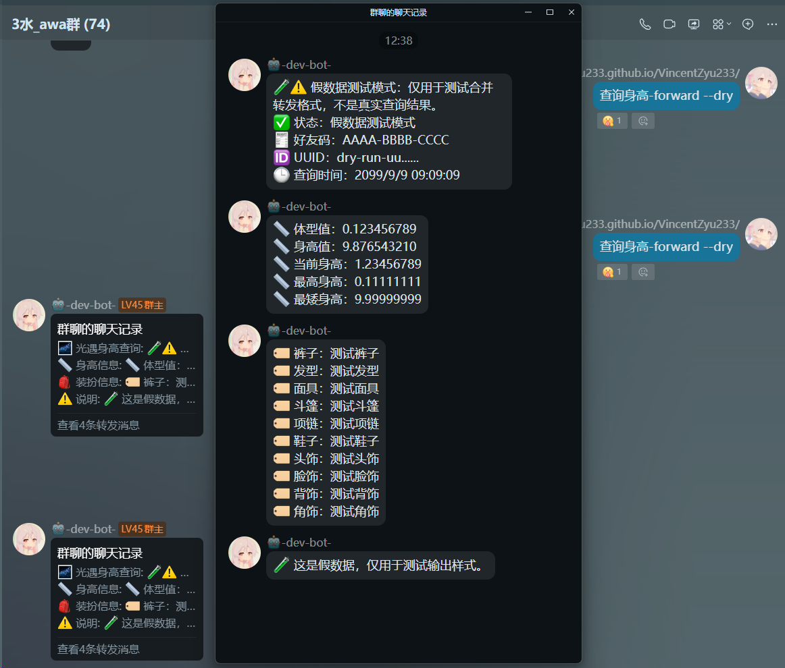
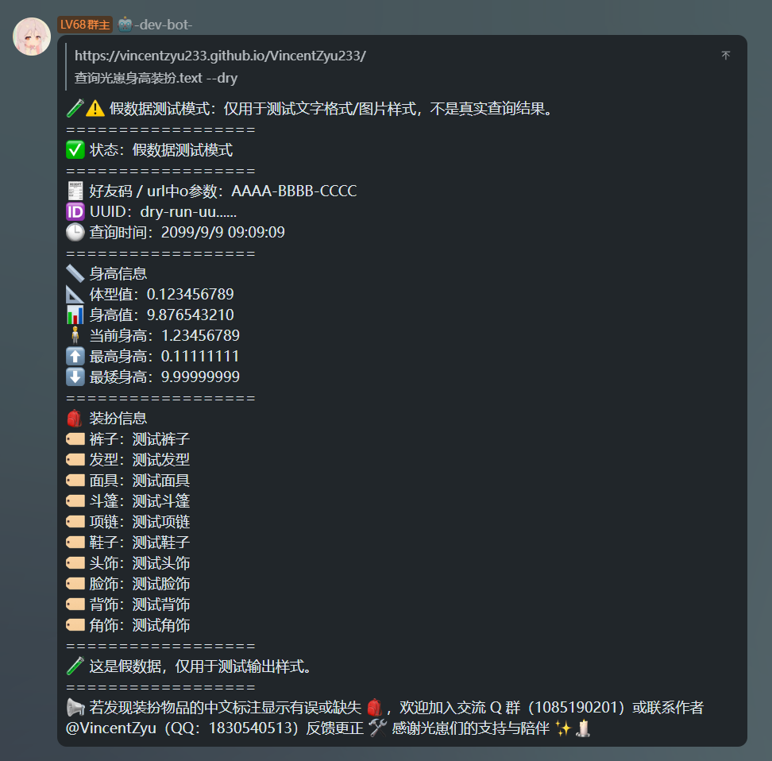
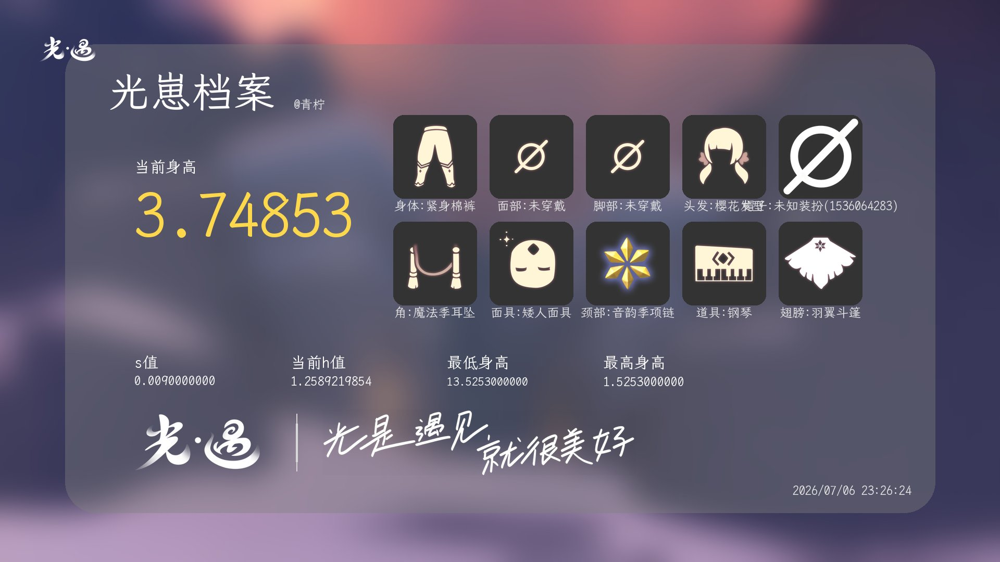
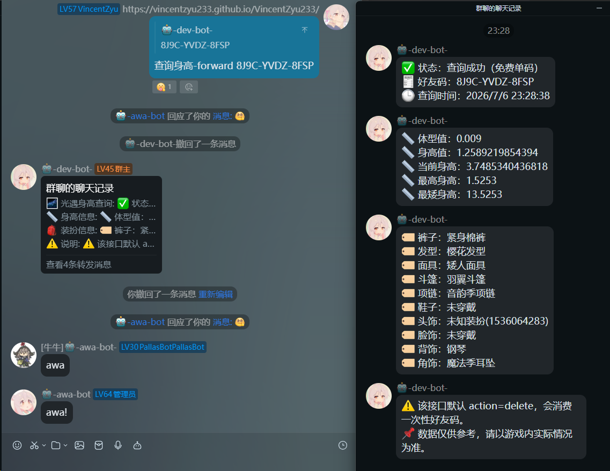
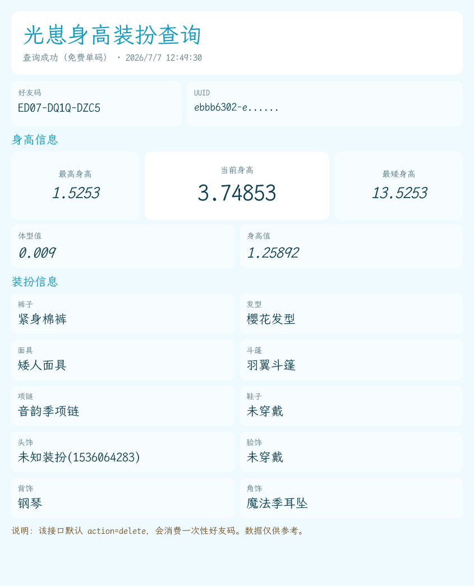
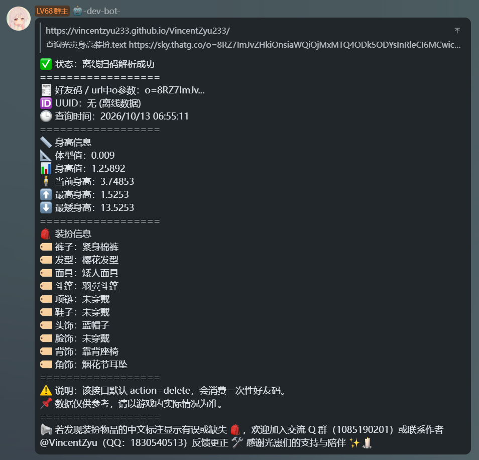

# koishi-plugin-skykid-height-cosmetic-query

[](https://www.npmjs.com/package/koishi-plugin-skykid-height-cosmetic-query)
[](https://www.npmjs.com/package/koishi-plugin-skykid-height-cosmetic-query)

[](https://github.com/VincentZyuApps/koishi-plugin-skykid-height-cosmetic-query)
[](https://gitee.com/vincent-zyu/koishi-plugin-skykid-height-cosmetic-query)

[](https://forum.koishi.xyz/t/topic/xxxxx)
[](https://qm.qq.com/q/ZN7fxZ3qCq)

<h2>💬 交流反馈</h2>
<p>🐛 Bug 反馈 / 💡 建议 / 👨‍💻 插件开发交流，欢迎加群：</p>
<p><del>💬 插件使用问题 / 🐛 Bug反馈 / 👨‍💻 插件开发交流，欢迎加入QQ群：<b>259248174</b>   🎉（这个群G了）</del></p> 
<p>💬 插件使用问题 / 🐛 Bug反馈 / 👨‍💻 插件开发交流，欢迎加入QQ群：<b>1085190201</b> 🎉</p>
<p>💡 在群里直接艾特我，回复的更快哦~ ✨</p>

🌌 查询国服光遇的玩家身高信息捏。基于 `sky.cesgao.cn` 的光遇好友码身高查询插件。

`XXXX-XXXX-XXXX` 表示光遇一次性好友码，例如 `ABCD-EFGH-IJKL`。也支持不带横杠的 12 位好友码。

## 📌 指令

默认前缀是 `查询光崽身高装扮`。默认前缀别名是 `查询光崽身高`、`查询光崽装扮`、`查询身高`、`查询装扮`、`测身高`，每个前缀都会和相同后缀组合成可用指令。

```text
查询光崽身高装扮.帮助
查询光崽身高装扮.pptr XXXX-XXXX-XXXX
查询光崽身高装扮.text XXXX-XXXX-XXXX
查询光崽身高装扮.forward XXXX-XXXX-XXXX
查询光崽身高装扮.takumi XXXX-XXXX-XXXX
查询光崽身高装扮.api XXXX-XXXX-XXXX
查询光崽身高装扮.md-style XXXX-XXXX-XXXX
查询光崽身高装扮.md-table XXXX-XXXX-XXXX

查询光崽身高.pptr XXXX-XXXX-XXXX
查询光崽装扮.pptr XXXX-XXXX-XXXX
```

## 🧪 测试模式

所有查询命令都支持 `--dry` / `--dryrun`。测试模式不会请求后端，只使用假数据测试文字或图片样式。

```text
查询光崽身高装扮.pptr --dryrun
查询光崽身高装扮.text --dry
查询光崽身高装扮.forward --dryrun
查询光崽身高装扮.takumi --dryrun
查询光崽身高装扮.api --dryrun
查询光崽身高装扮.md-style --dryrun
查询光崽身高装扮.md-table --dryrun
```

## 🌙 深色模式

Puppeteer 和 Takumi 出图命令支持 `-d` / `--dark` / `--darkmode`。可选值：`true` / `false` / `on` / `off` / `dark` / `light` / `深色` / `浅色`。

```text
查询光崽身高装扮.pptr XXXX-XXXX-XXXX -d true
查询光崽身高装扮.pptr XXXX-XXXX-XXXX --dark on
查询光崽身高装扮.takumi XXXX-XXXX-XXXX --dark dark
查询光崽身高装扮.takumi XXXX-XXXX-XXXX --darkmode 深色
```

## 🛠️ 调试参数

所有查询命令支持 `-v` / `--verbose`，会在 session 和 console 打印本次命令解析到的详细参数。

```text
查询光崽身高装扮.pptr --dryrun -v
```

## 🖼️ 输出方式

- 📝 `text`：纯文本
- 📨 `forward`：OneBot 合并转发
- 🖼️ `pptr`：Puppeteer 出图
- ⚡ `takumi`：`@takumi-rs/wasm` 出图
- 🌐 `api`：调用外部 Fastapi Pillow画图后端出图
- 💫 `md-style`：QQ 官方 Bot Markdown 格式风格
- 📊 `md-table`：QQ 官方 Bot Markdown 表格

## 💬 QQ 官方 Bot Markdown

QQ Markdown 相关输出仅支持 Koishi 的 QQ 官方 Bot 平台，非 QQ 平台不会 fallback 成其他格式。默认会注册 `查询光崽身高装扮.md-style`，`查询光崽身高装扮.md-table` 默认关闭，可在配置里开启。

按钮行为由 `qqMarkdownButtonMode` 控制，默认勾选所有 append 行为，不勾选 standalone。`append-api-image` / `append-pptr-image` / `append-takumi-image` 需要对应的内联图片开关为 `true` 才能挂按钮；否则默认静默跳过，只有开启 `verboseSessionLog` / `verboseConsoleLog` 才会提示。

Puppeteer / Takumi 是本地生成图片。若要嵌入 QQ Markdown，需要通过 `server` 或 `assets` 生成公网图片 URL；server 模式缓存目录为 `ctx.baseDir/cache/skykid-height-cosmetic-query`，暴露路由为 `/skykid-height-cosmetic-query/cache/:name`。

## 🖼️ 效果预览

### 🧪 测试模式 dryrun

| 输出方式 | 预览 |
| --- | --- |
| pptr<br>（浏览器截图出图）<br>`查询光崽身高装扮.pptr` |  |
| api<br>（外部 Pillow 后端出图）<br>`查询光崽身高装扮.api` |  |
| forward<br>（OneBot 合并转发）<br>`查询光崽身高装扮.forward` |  |
| takumi<br>（wasm 渲染图片）<br>`查询光崽身高装扮.takumi` |  |
| text<br>（直接拼接文本）<br>`查询光崽身高装扮.text` |  |

### 🌐 真实查询 live

| 输出方式 | 预览 |
| --- | --- |
| pptr<br>（浏览器截图出图）<br>`查询光崽身高装扮.pptr` |  |
| api<br>（外部 Pillow 后端出图）<br>`查询光崽身高装扮.api` |  |
| forward<br>（OneBot 合并转发）<br>`查询光崽身高装扮.forward` |  |
| takumi<br>（wasm 渲染图片）<br>`查询光崽身高装扮.takumi` |  |
| text<br>（直接拼接文本）<br>`查询光崽身高装扮.text` |  |

## ⚙️ 配置项

### 🌐 后端设置

| 配置名 | 类型 | 默认值 | 备注 |
| --- | --- | --- | --- |
| `baseUrl` | `string` | `https://sky.cesgao.cn` | `sky.cesgao.cn` 基础地址。 |
| `powChallengeUrl` | `string` | `https://sky.cesgao.cn/web/v1/pow/challenge` | POW challenge 接口地址。 |
| `queryUrl` | `string` | `https://sky.cesgao.cn/web/v1/query` | 身高查询接口地址。 |
| `httpTimeout` | `number` | `75` | HTTP 总超时时间，单位秒。 |
| `queryTimeout` | `number` | `60` | 提交给查询接口的 `timeout` 参数，单位秒。 |
| `queryAction` | `string` | `delete` | 提交给查询接口的 `action` 参数；默认会消费一次性好友码。 |
| `powMaxNonce` | `number` | `20000000` | POW 最大尝试 nonce。 |
| `sendRunningTip` | `boolean` | `true` | 查询前是否发送“⏳ 正在查询”提示。 |
| `userAgent` | `string` | `Edge/Chrome UA` | 请求查询接口时使用的 User-Agent。 |

### 📌 指令设置

| 配置名 | 类型 | 默认值 | 备注 |
| --- | --- | --- | --- |
| `commandPrefix` | `string` | `查询光崽身高装扮` | 查询指令共同前缀；实际命令格式为 `前缀.后缀`。 |
| `commandPrefixAliases` | `string[]` | `查询光崽身高`, `查询光崽装扮`, `查询身高`, `查询装扮`, `测身高` | 查询指令前缀别名；每个别名都会和相同后缀组合成指令 alias，例如 `查询光崽身高.pptr`。 |
| `enableHelpCommand` | `boolean` | `true` | 注册帮助指令。 |
| `helpCommandSuffix` | `string` | `帮助` | 帮助指令后缀。 |
| `enableTextCommand` | `boolean` | `true` | 注册纯文本查询指令。 |
| `textCommandSuffix` | `string` | `text` | 纯文本指令后缀。 |
| `enableForwardCommand` | `boolean` | `true` | 注册 OneBot 合并转发查询指令。 |
| `forwardCommandSuffix` | `string` | `forward` | OneBot 合并转发指令后缀。 |
| `enablePptrCommand` | `boolean` | `true` | 注册 Puppeteer 出图查询指令。 |
| `pptrCommandSuffix` | `string` | `pptr` | Puppeteer 出图指令后缀。 |
| `enableTakumiCommand` | `boolean` | `true` | 注册 Takumi wasm 出图查询指令。 |
| `takumiCommandSuffix` | `string` | `takumi` | Takumi wasm 出图指令后缀。 |
| `enableApiCommand` | `boolean` | `false` | 注册外部 Fastapi Pillow画图后端出图查询指令。 |
| `apiCommandSuffix` | `string` | `api` | 外部 Fastapi Pillow画图后端出图指令后缀。 |
| `enableQqMdTableCommand` | `boolean` | `false` | 注册 QQ Markdown 表格模式查询指令；仅 QQ 官方 Bot 平台支持。 |
| `qqMdTableCommandSuffix` | `string` | `md-table` | QQ Markdown 表格模式指令后缀。 |
| `enableQqMdStyleCommand` | `boolean` | `true` | 注册 QQ Markdown 格式风格查询指令；仅 QQ 官方 Bot 平台支持。 |
| `qqMdStyleCommandSuffix` | `string` | `md-style` | QQ Markdown 格式风格指令后缀。 |

### 💬 通用输出设置

| 配置名 | 类型 | 默认值 | 备注 |
| --- | --- | --- | --- |
| `enableQuote` | `boolean` | `true` | 回复时是否引用触发消息。 |
| `textMaxLength` | `number` | `1500` | 纯文本输出最大长度。 |
| `hideFullUuid` | `boolean` | `true` | 是否不显示完整 UUID；开启后显示前 10 个字符并追加 `......`，关闭后显示完整 UUID。 |
| `showFullUnknownOutfitId` | `boolean` | `false` | 未知装扮是否显示完整 ID；默认隐藏，`未知装扮(123456)` 会显示为 `未知装扮(123...)`。 |
| `useCustomFont` | `boolean` | `true` | 是否使用自定义字体路径；开启后会检查 `ctx.baseDir/data/fonts/LXGWWenKaiMono-Regular.ttf`，缺失或 hash 校验失败时尝试从 Gitee / GitHub 下载；关闭后 Puppeteer / Takumi 使用系统默认字体，并跳过字体下载。 |

### 🖼️ Puppeteer 出图设置

| 配置名 | 类型 | 默认值 | 备注 |
| --- | --- | --- | --- |
| `pptrWidth` | `number` | `880` | Puppeteer 图片宽度。 |
| `pptrDeviceScaleFactor` | `number` | `2.5` | Puppeteer 截图设备像素比，越高越清晰但图片体积越大。 |
| `pptrImageType` | `"png" \| "jpeg" \| "webp"` | `png` | Puppeteer 图片类型。 |
| `pptrCardColorMode` | `"solid" \| "fixed" \| "random"` | `random` | Puppeteer 圆角矩形配色模式；`solid` 完全纯色，`fixed` 固定的随便感，`random` 完全随机。 |
| `pptrQuality` | `number` | `90` | Puppeteer 图片质量；`png` 无效。 |
| `pptrFontPath` | `string` | `process.cwd()/data/fonts/LXGWWenKaiMono-Regular.ttf` | Puppeteer 字体路径；运行时会映射到 `ctx.baseDir/data/fonts/LXGWWenKaiMono-Regular.ttf`，留空则使用系统默认字体。 |
| `pptrShowRenderInfo` | `boolean` | `true` | Puppeteer 回复中是否显示渲染耗时。 |

### ⚡ Takumi wasm 出图设置

| 配置名 | 类型 | 默认值 | 备注 |
| --- | --- | --- | --- |
| `takumiWidth` | `number` | `880` | Takumi 图片宽度。 |
| `takumiDarkMode` | `boolean` | `false` | Takumi 默认是否使用深色模式。 |
| `takumiFontPath` | `string` | `process.cwd()/data/fonts/LXGWWenKaiMono-Regular.ttf` | Takumi 字体路径；运行时会映射到 `ctx.baseDir/data/fonts/LXGWWenKaiMono-Regular.ttf`。 |
| `takumiShowRenderInfo` | `boolean` | `true` | Takumi 回复中是否显示渲染耗时。 |

### 🌐 API 出图设置

说明：按照上游作者要求，Fastapi Pillow画图后端闭源，请直接调用已部署的 API；当前默认地址仍保留为本机 `http://127.0.0.1:60704`，可按实际部署修改 `imageApiBaseUrl`。

| 配置名 | 类型 | 默认值 | 备注 |
| --- | --- | --- | --- |
| `imageApiBaseUrl` | `string` | `http://127.0.0.1:60704` | 外部出图 API 基础地址；默认与 `imageApiPath` 组合为 `GET http://127.0.0.1:60704/img/render`，跨机器运行时填写 API 所在机器地址。 |
| `imageApiPath` | `string` | `/img/render` | 外部出图 API 图片路径；默认对接 Fastapi Pillow画图后端的 `/img/render`。背景、logo、字体和版式建议在 Fastapi Pillow画图后端的 `config/config.yaml` 调整。 |
| `imageApiTimeout` | `number` | `60` | 外部出图 API 请求超时时间，单位秒。 |
| `imageApiWidth` | `number` | `1920` | 传给外部出图 API 的 `bg_x` 输出宽度。 |
| `imageApiHeight` | `number` | `1080` | 传给外部出图 API 的 `bg_y` 输出高度。 |
| `imageApiShowOutfitName` | `boolean` | `true` | 是否显示具体装扮名称，对应 `body-txt_name` / `hair-txt_name` 等参数。 |
| `imageApiExtraQueryParams` | `string` | 空字符串 | 追加给外部出图 API 的 URL 查询参数，例如 `gm=20&title_txt=光崽档案`；同名 query 会覆盖插件自动生成的 query。完整填写手册见 Fastapi Pillow画图后端的 `/koishi-query-doc`。 |
| `imageApiShowRenderInfo` | `boolean` | `true` | API 出图回复中是否显示查询和出图总耗时。 |

### 💬 QQ 官方 Bot Markdown 适配设置

| 配置名 | 类型 | 默认值 | 备注 |
| --- | --- | --- | --- |
| `qqMarkdownButtonMode` | `string[]` | append 除 standalone 外全部勾选 | QQ Markdown 按钮发送行为；包含 `append-text` / `append-api-image` / `append-pptr-image` / `append-takumi-image` / `append-md-table` / `append-md-style` / `standalone`。 |
| `qqMarkdownKeyboardJson` | `string` | 空字符串 | QQ Markdown 按钮 JSON；留空时默认一行两个按钮：获取帮助 -> 当前前缀.帮助，玩玩别的 -> help。 |
| `qqMarkdownImageStorageMode` | `"assets" \| "server"` | `server` | Puppeteer / Takumi 本地图片转公网 URL 的方式。 |
| `qqMarkdownImageSelfUrl` | `string` | 空字符串 | server 模式公网 URL 覆盖值；留空则回退 `ctx.server.config.selfUrl`。 |
| `qqMarkdownImageMaxFiles` | `number` | `5` | server 模式缓存图片数量上限；`<= 0` 表示不限制。 |
| `qqMarkdownEmbedApiImage` | `boolean` | `true` | QQ 官方平台下，API 出图是否改为 QQ Markdown 内联图片。 |
| `qqMarkdownEmbedPptrImage` | `boolean` | `true` | QQ 官方平台下，Puppeteer 出图是否改为 QQ Markdown 内联图片。 |
| `qqMarkdownEmbedTakumiImage` | `boolean` | `true` | QQ 官方平台下，Takumi 出图是否改为 QQ Markdown 内联图片。 |

### 🛠️ 调试设置

| 配置名 | 类型 | 默认值 | 备注 |
| --- | --- | --- | --- |
| `verboseSessionLog` | `boolean` | `false` | 是否在会话中输出详细调试信息；QQ Markdown / 按钮跳过提醒默认不会发送到会话。 |
| `verboseConsoleLog` | `boolean` | `false` | 是否在控制台输出详细调试信息；QQ Markdown / 按钮跳过提醒默认不会输出到控制台。 |

## ⚠️ 注意

默认 `queryAction=delete`，会消费一次性好友码。请只提交准备使用的好友码。
